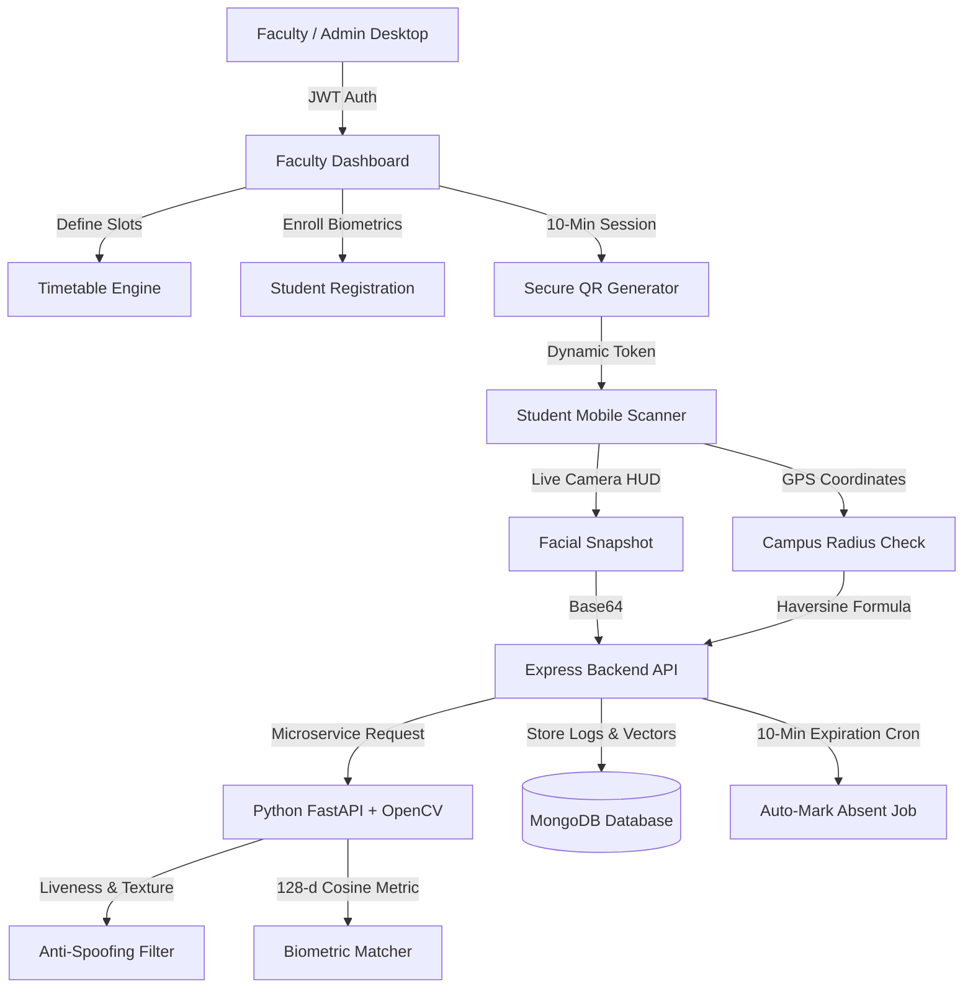

# AI Face Recognition Attendance System (MERN + FastAPI OpenCV)

An enterprise-grade, fully responsive AI-powered Face Recognition Attendance System tailored for colleges and universities. The platform features two completely distinct interfaces, high-precision biometric recognition, multi-vector anti-spoofing detection, campus GPS geofencing, and timetable scheduling integration.

---

## 🏛️ System Architecture



---

## 📱 Interface 1: Student Interface (Mobile / Tablet Scanner)

Designed strictly for mobile & tablet viewing with zero dashboard access:
- **Direct Entry via Faculty QR Code:** Students scan the classroom projected QR code which opens `/scan?token=...`.
- **Fullscreen Camera Feed with Live Face Detection Box:**
  - Sci-Fi HUD overlay with corner targeting reticles (`bracket-tl`, `bracket-tr`, `bracket-bl`, `bracket-br`).
  - Animated horizontal laser scanline.
  - Face alignment guide oval.
- **Real-Time Status Indicators:**
  - `QR Verified ✅`: Verifies cryptographic token validity and active session window.
  - `Within Campus Radius 📍`: Live GPS Haversine verification against campus coordinates (500m radius).
- **Required Instruction Text:** `"Place your face in front of the camera."`
- **Attendance Logic:**
  - **Present:** Student face matches registered 128-d biometric embedding with confidence $\ge 70\%$.
  - **Late:** Scanned in the final 3 minutes of the 10-minute session.
  - **Absent:** If the student does not scan within the 10-minute session duration, the backend cron automatically logs them as **Absent**.
- **Auto-Close:** Displays verified celebration card (Student name, Roll number, Confidence %, Liveness status) and triggers a 5-second auto-close countdown.
- **Strict Role Isolation:** Students have **no dashboard access**; any attempt to navigate to administrative routes is blocked.

---

## 💻 Interface 2: Faculty/Admin Dashboard (Desktop / Tablet View)

Header: **"AI Attendance Dashboard"**
- **Authentication:** Secure login using JWT tokens with automatic session persistence.
  - **Demo Faculty Credentials:** `prof.sharma@college.edu` / `Password@123` (Includes a 1-click quick-fill button).
- **Student Enrollment (`/register-student`):**
  - Live webcam snapshot capture or file upload.
  - Student Name, Roll Number, Department, Semester, and College Email.
  - Extracts 128-dimensional biometric embeddings and validates uniqueness.
- **Secure QR Attendance Session Generator (`/generate-qr`):**
  - Session Duration Slider (Default: **10 minutes**, adjustable from 5 to 30 mins).
  - Classroom Projector Mode: High-resolution QR code projection modal with live circular countdown timer.
  - Direct student testing link and link copy button.
- **Timetable Scheduling & Auto-Alignment (`/timetable`):**
  - Week schedule view (Monday to Saturday).
  - Add and delete lecture slots (Subject, Course Code, Day, Time, Lecture Hall).
  - **Auto-Alignment Engine:** Automatically detects the current lecture slot based on system clock and provides a 1-click **"Launch Attendance for Active Slot"** button.
- **Daily Attendance Logs (`/attendance-log`):**
  - Student photo thumbnail, Name, Roll number, Subject, Time, Status badge (Present, Absent, Late).
  - AI Biometric Confidence % and Anti-Spoof risk score.
  - Filters by Subject, Date, Status, and Search by student or roll number.
- **Analytics Charts:**
  - Donut percentage chart: Present %, Absent %, Late %.
  - Subject-wise attendance rate progress comparison.
- **Report Exporting:**
  - Instant CSV export download.
  - Formatted printable report.
- **Anti-Spoofing & Security Alerts Panel:**
  - Live alert feed flagging photo replay attacks, screen glare spikes, and out-of-campus GPS spoofing attempts.

---

## ⚙️ Backend API Routes & Specifications

### 1. Student Biometrics & Registration
| Method | Endpoint | Description | Auth Required |
|---|---|---|---|
| `POST` | `/register-student` | Enroll student face snapshot, generate 128-d embeddings | Faculty JWT |
| `GET` | `/api/students` | List all active enrolled students | Faculty JWT |
| `DELETE` | `/api/students/:id` | Deactivate student biometric profile | Faculty JWT |

### 2. Attendance Sessions & QR Code
| Method | Endpoint | Description | Auth Required |
|---|---|---|---|
| `POST` | `/generate-qr` | Generate signed JWT session QR code & 10-min countdown | Faculty JWT |
| `GET` | `/api/sessions/status/:token` | Check token validity, remaining time, and campus coords | Public |
| `GET` | `/api/sessions/active` | Get faculty's currently active live session | Faculty JWT |
| `POST` | `/api/sessions/close/:id` | Terminate session manually & trigger auto-absent logic | Faculty JWT |

### 3. Face Scanning & Attendance Logging
| Method | Endpoint | Description | Auth Required |
|---|---|---|---|
| `POST` | `/scan-face` | Verify student face snapshot + QR token + GPS geofence | QR Token |
| `GET` | `/attendance-log` | Fetch daily & semester logs with filter parameters | Faculty JWT |
| `GET` | `/api/attendance/stats` | Aggregated analytics for Donut and Bar charts | Faculty JWT |
| `GET` | `/api/attendance/export-csv` | Download attendance records as CSV file | Faculty JWT |
| `GET` | `/api/attendance/suspicious-alerts` | Security log of anti-spoof and GPS violation attempts | Faculty JWT |

### 4. Timetable Management
| Method | Endpoint | Description | Auth Required |
|---|---|---|---|
| `GET` | `/timetable` | Retrieve all scheduled lecture slots for faculty | Faculty JWT |
| `GET` | `/api/timetable/active-slot` | Detect lecture slot currently active right now | Faculty JWT |
| `POST` | `/timetable` | Create new lecture timetable slot | Faculty JWT |
| `DELETE` | `/api/timetable/:id` | Remove timetable slot | Faculty JWT |

---

## 🛡️ Anti-Spoofing & Security Layer

The Python AI Microservice (`ai-service/app.py`) provides 3-tier liveness verification:
1. **Laplacian Texture Sharpness Variance:** Detects blurred print-outs, washed-out paper copies, or artificial focus.
2. **2D Fourier Frequency Spectrum (Moiré Filtering):** Detects pixel refresh rasterization patterns characteristic of smartphone and laptop displays.
3. **HSV Specular Glare Analysis:** Detects concentrated reflection points from device backlights.
4. **Haversine Geofencing:** Verifies student coordinates against campus center (`12.9716, 77.5946`) within a 500m radius.

---

## 🚀 Running the System

### Prerequisites
- Node.js $\ge 18$
- Python $\ge 3.10$
- MongoDB Server running locally on `localhost:27017`

### 1. Python AI Microservice
```bash
cd ai-service
python -m uvicorn app:app --host 127.0.0.1 --port 5001
```

### 2. Node.js Express Backend
```bash
cd backend
npm install
node src/seed.js    # Seed demo faculty, students, timetable, and logs
node src/server.js  # Runs on http://localhost:5000
```

### 3. React Vite Frontend
```bash
cd frontend
npm install
npm run dev         # Runs on http://localhost:5174
```

### Accessing the Interfaces:
- **Faculty Dashboard:** Open [http://localhost:5174](http://localhost:5174) (Click "1-Click Demo Fill" to sign in as Prof. Rajesh Sharma).
- **Student Scanner:** Open [http://localhost:5174/scan](http://localhost:5174/scan) or scan the QR code projected by faculty.
