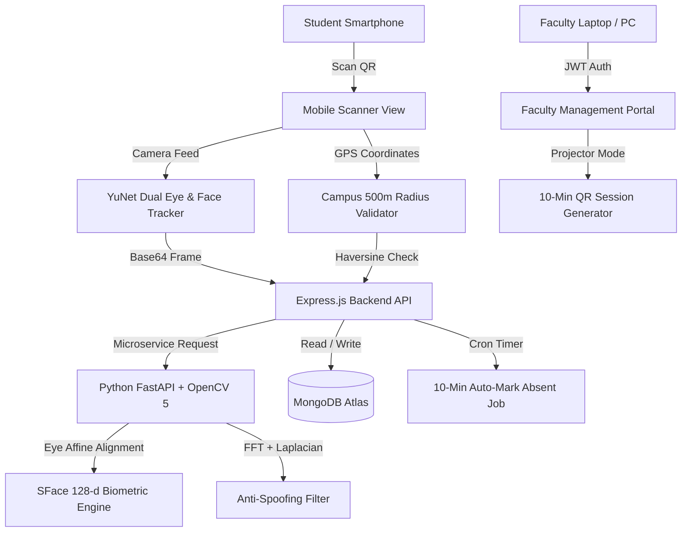

# AI Face & Eye Recognition Attendance System (Production Ready)

An enterprise-grade, fully responsive AI-powered Biometric Attendance Platform engineered for colleges, universities, and institutions. Built with **React 19**, **Express 5**, **FastAPI**, **OpenCV 5**, **YuNet Deep Neural Landmark Detector**, and **SFace 128-d Biometric Embeddings**.

---

## 🌟 Key Highlights & Real-World Features

### 1. High-Precision Face & Eye Pattern Biometrics (YuNet + SFace)
- **Deep Face & Landmark Tracking:** Sub-pixel detection of left eye, right eye, nose bridge/tip, and mouth corners using OpenCV 5 YuNet (`face_detection_yunet.onnx`).
- **Eye-Centric Affine Alignment:** Uses eye pupil coordinates to perform affine rotation and scaling (`alignCrop`), eliminating head tilt variations and ensuring high recognition accuracy.
- **128-Dimensional Deep Embeddings:** Extracts normalized facial feature vectors using SFace (`face_recognition_sface.onnx`) trained on millions of face profiles.
- **Biometric Landmark Lock Reticle:** Real-time dual eye tracking indicators and facial contour targeting on mobile and desktop viewfinders.

### 2. Multi-Vector Anti-Spoofing & Liveness Engine
- **Laplacian Sharpness Variance:** Detects paper printouts, posters, and blurry spoof attempts.
- **2D Discrete Fourier Transform (FFT):** Identifies Moiré micro-grid interference patterns produced by LCD/OLED smartphone screen replays.
- **Specular Glare & Backlight Saturation:** Inspects HSV value channels for artificial device backlight reflection.
- **Landmark Geometry & Eye Proportion Verification:** Ensures natural human facial triangle proportions.

### 3. Real User Authentication (Firebase-Level Security)
- **No Fake / Demo Hardcoding:** All mock accounts purged; supports real institutional email registration.
- **Strict RFC 5322 Email Validation:** Enforces valid domain formats (`.edu`, `.ac.in`, `.com`, etc.).
- **Password Hardening:** Minimum 8 characters with letters, numbers, and special characters; interactive password strength meter.
- **Brute-Force Rate Limiting:** `express-rate-limit` throttles authentication attempts (15 attempts / 15 minutes per IP) to prevent dictionary and credential stuffing attacks.
- **Self-Service Password Reset:** Integrated reset password mechanism with validation.
- **Security Headers:** `helmet` protections against clickjacking, MIME sniffing, and XSS.
- **NoSQL Injection Guard:** Safe type-casting and schema sanitization.

### 4. Fully Responsive Design (Mobile to 4K Displays)
- **Mobile Student Scanner (`100dvh`):** Fullscreen responsive camera viewport, camera flip toggle (Front/Rear), touch-friendly HUD badges.
- **Mobile Faculty Drawer:** Collapsible slide-out drawer navigation for smartphones and tablets (`< 768px`).
- **Large Screen & Projector Optimized:** Responsive tables, analytics grid, and fullscreen classroom QR projector modal.

---

## 🏛️ System Architecture



---

## 🚀 Quick Start (Local Development)

### Prerequisites
- Node.js 18+ (Node 20 recommended)
- Python 3.10+ (with OpenCV and FastAPI)
- MongoDB running locally or MongoDB Atlas connection string

### 1. Start Python AI Microservice
```bash
cd ai-service
pip install -r requirements.txt
python app.py
```
*Runs on `http://127.0.0.1:5001`*

### 2. Start Express Backend
```bash
cd backend
npm install
npm start
```
*Runs on `http://localhost:5000`*

### 3. Start React Frontend
```bash
cd frontend
npm install
npm run dev
```
*Runs on `http://localhost:5173`*

---

## 🧹 Database Clean & Reset Script

To purge any legacy demo accounts and ensure a 100% clean database for real users:
```bash
cd backend
npm run clean
```

---

## 🐳 Docker Deployment (One-Click)

Run the entire full-stack system with Docker Compose:

```bash
docker compose up -d --build
```

Access:
- **Frontend & Scanner:** `http://localhost:80`
- **Backend API:** `http://localhost:5000`
- **AI Microservice:** `http://localhost:5001`
- **MongoDB:** `localhost:27017`

---

## 📖 Step-by-Step Production Deployment Guide

A detailed production deployment manual covering MongoDB Atlas, Render/Railway, VPS Nginx configuration, and Let's Encrypt SSL is available in:
- [Production Deployment Guide](deployment_guide.md)
